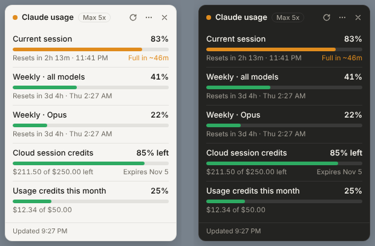

# Claude Usage Tray

A small Windows app that shows how much of your **Claude plan** you've used: the 5-hour session limit, your weekly limits, and your credits (such as included cloud session credits and usage credits). It lives in the system tray and in a compact, always-on-top widget, so you can see what's left without opening claude.ai.



## What it's for

If you use Claude Pro, Max, Team or Enterprise (in the app, on claude.ai or in Claude Code), your usage counts against a rolling 5-hour session limit and a weekly limit. The only official place to see them is **Settings → Usage** on claude.ai. This app keeps those numbers on screen all the time, so you can:

- **Pace yourself.** See how far into your session you are, and get a "Full in ~X" estimate when your current pace would hit the limit before it resets.
- **Know when it resets.** Live countdowns for the session and each weekly limit.
- **Get warned before you're cut off.** Optional desktop alerts at the levels you choose, and an optional alert when your session resets.
- **Plan heavy work.** Check whether you have room for a long Claude Code run or a big research task before you start.

## Features

- **Tray icon** with your current session % (or your highest limit), color-coded green → yellow → orange → red. Hover over it for a summary.
- **Floating widget**, always on top and draggable (it remembers its position), in light and dark mode. Shows:
  - The current session limit.
  - Weekly limits for all models, plus per-model weekly limits (such as Opus or Fable) once you start using them.
  - Included credits, such as cloud session credits: how much is left and when they expire.
  - Usage credits spent this month, when you have them turned on.

  It shows the same limits and labels as claude.ai's **Settings → Usage** page.
- **Optional alerts** at 50 / 75 / 80 / 90 / 95 / 100%. Each one fires once per limit window. There's also a "session reset" notification, and a test button.
- **Settings** from the tray menu: refresh interval (30 s to 5 min), icon style (number or ring), widget opacity, and Start with Windows.
- **Private.** You sign in on claude.ai's own page inside the app, so your password never touches this code. Your session stays on your PC. The app only talks to claude.ai, with no analytics or telemetry.

## Install (Windows 10 / 11)

Download from the [latest release](../../releases/latest). There are two options:

### Installer (recommended)

1. Download **`ClaudeUsageTray-Setup-1.1.0.exe`** and run it.
   - If SmartScreen shows *"Windows protected your PC"*, click **More info → Run anyway**. The app isn't code-signed.
2. It installs in a few seconds, just for you (no admin rights needed), adds Start Menu and desktop shortcuts, and starts the app.
3. Sign in to Claude in the window that opens (email code, Google or Apple). It closes on its own and the widget appears.

**Updates are automatic.** The installed app checks this repo's releases every few hours, downloads new versions in the background, verifies each download against the SHA-512 checksum published with the release, and installs the update the next time you quit (or right away with **Restart to update** in the tray menu). Turn it off under **Settings → Install updates automatically**, or use **Check for updates** in the tray menu.

### Portable zip

1. Download **`ClaudeUsageTray-1.1.0-win-x64.zip`**, right-click it → **Extract All…**, and keep the folder somewhere permanent.
2. Run **`Claude Usage Tray.exe`** from that folder and sign in.

The zip copy doesn't update itself; download a new zip to update.

**Tips**
- The tray icon may be hidden under the **^** next to the clock. Drag it onto the taskbar to keep it visible.
- Left-click the tray icon to show or hide the widget. Right-click it for the menu.

Each person signs in with their own account, so you can share the app with friends and it shows their own usage.

## Uninstall

- **Installer:** Windows **Settings → Apps → Installed apps → Claude Usage Tray → Uninstall**.
- **Zip:** turn off **Start with Windows** if you enabled it, quit from the tray menu, and delete the folder.

Your settings and sign-in live in `%APPDATA%\Claude Usage Tray`. Delete that folder too to remove everything (or use **Sign out of Claude** first).

## How it works

The app reads the same JSON that claude.ai's **Settings → Usage** page uses:

```
GET https://claude.ai/api/organizations             → your organization id
GET https://claude.ai/api/organizations/{id}/usage  → five_hour, seven_day, seven_day_opus, …
```

The app reads the `limits` list (session, weekly, per-model weekly) that claude.ai's usage page uses, falls back to the older `five_hour` / `seven_day` fields on older accounts, and shows included credit allowances in dollars. The response also contains many internal code-named fields; the app never shows those as limits. The approach follows the open-source [Claude Monitor](https://github.com/claude-monitor/claude-monitor-browser-extension) browser extension. If claude.ai asks for a browser check, the request runs inside a hidden claude.ai page instead.

Claude doesn't publish token counts for plan limits, so the app shows percentages, the same as claude.ai.

## Build from source

Requires Node.js 20+.

```bash
npm install
npm start            # run in development
npm run demo         # run with sample data, no sign-in needed
npm test             # unit tests (parsing, pace, icons)
npm run test:e2e     # end-to-end test against a mock claude.ai
npm run dist         # build, brand and verify the app, then the installer, zip and latest.yml
```

Built with Electron. The tray icons are drawn in code, so there are no image assets. `lib.js` holds the pure logic; `main.js` the Electron side.

## Security

The app shows a real website (claude.ai) inside its own windows, so it's locked down accordingly:

- Every window runs **sandboxed** with **context isolation** and no Node.js access. The widget has a strict Content-Security-Policy and only a small message bridge.
- The sign-in window can only visit claude.ai and the Google/Apple sign-in pages. Any other link opens in your normal browser, and only plain `http(s)` links ever leave the app (no `file:` or other protocol handlers).
- claude.ai gets **no** camera, microphone, location, notification or download permissions inside the app.
- Electron **fuses** are set: cookies are encrypted at rest, and the exe can't be run as plain Node or with debugging flags. The app code is checked for integrity at launch.
- Requests are hard-coded to `https://claude.ai/api/…` and time out after 20 seconds. Nothing from the network is ever run as code.
- **Sign out** clears all stored cookies and cache.
- **Updates** come only from this repo's GitHub Releases over HTTPS, and each download must match the SHA-512 checksum in the release's `latest.yml` before it installs. Because the app isn't code-signed, protect the GitHub account that publishes releases with two-factor authentication.

## Troubleshooting

| Problem | Fix |
|---|---|
| Widget says **Sign in** | Your claude.ai session expired. Click **Sign in**. |
| Google sign-in won't go through | Use **Continue with email** and enter the code Claude emails you. |
| Numbers look stale | Tray menu → **Refresh now**. |
| Widget is off-screen | Quit, then delete `%APPDATA%\Claude Usage Tray\settings.json`. |

## Changes

See [CHANGELOG.md](CHANGELOG.md).

## Support

Questions, bugs or ideas: [open an issue](../../issues) or email **support@dilloncain.com**.

## Disclaimer

This is an unofficial tool. It isn't made by, affiliated with, or endorsed by Anthropic. It reads an internal claude.ai endpoint, so a future change to claude.ai could break it. Claude is a trademark of Anthropic PBC.

## License

[MIT](LICENSE) © 2026 Dillon Cain
